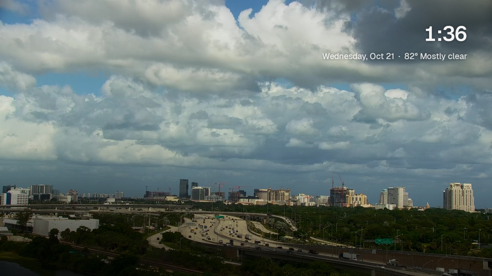
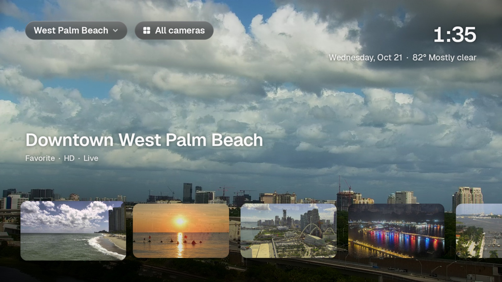
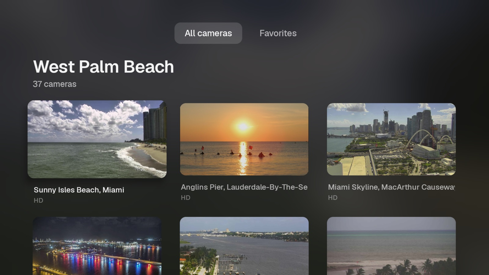
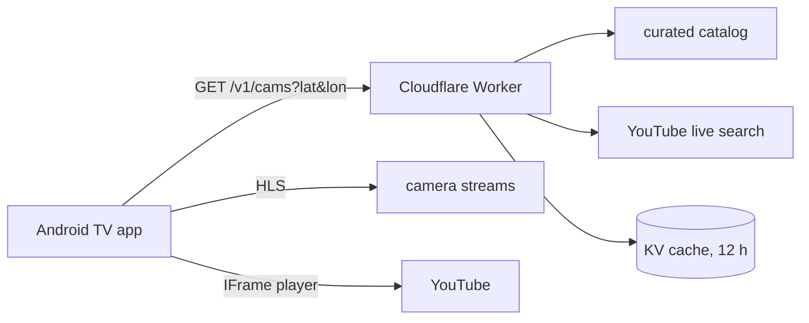

<h1 align="center">Panes</h1>

<p align="center">
  Live cameras as ambient TV.<br>
  Beaches, harbours and skylines, full screen, nothing in the way.
</p>

<p align="center">
  <a href="#run-it-yourself">Run it</a> ·
  <a href="#how-it-works">How it works</a> ·
  <a href="#add-a-camera">Add a camera</a> ·
  <a href="LICENSE">License</a>
</p>

<p align="center">
  
</p>

---

Panes is an Android TV app and a small Cloudflare Worker. Pick a city and it puts the best live camera near you on screen, then gets out of the way. Leave it on, or let it run as the screensaver.

It is built like a first-party TV app: the picture is the interface, focus is the cursor, and everything works with a D-pad. No typing, no menus you have to think about.

|  |  |
|---|---|
| **100+ curated cameras** | Many at 1080p, some at 4K. Dead feeds drop out on their own |
| **Ranked, not listed** | Clean views first, then resolution, then distance from you |
| **Near you** | Cameras within 120 km of the city you pick, plus live YouTube search |
| **Light on the TV** | One Activity, Media3 for HLS, no UI framework. Smooth on modest TV hardware |
| **A real screensaver** | Clock and weather over the picture, like Aerial |

## Screens

<p align="center">
  
  
</p>

Down opens the shelf, Select on All cameras opens the grid, Back always goes up one level.

## How it works



The TV never talks to the YouTube API. The Worker holds the key, caps searches at 90 a day, caches each half-degree cell, and falls back to the last good answer. The app plays HLS with Media3 and YouTube through the official IFrame player. Panes never downloads or re-hosts video: every stream stays with its owner.

## Run it yourself

You need Android Studio's SDK, [Bun](https://bun.sh), and a Cloudflare account.

**1. Deploy the Worker**

```sh
cd server
bun install
bunx wrangler kv namespace create CAMS      # paste the id into wrangler.jsonc
bunx wrangler secret put YOUTUBE_API_KEY    # optional: without it, catalog only
bun run deploy
```

**2. Build the app**

Create `local.properties` (gitignored):

```properties
sdk.dir=/path/to/Android/sdk
panes.server=https://<your-worker>.workers.dev
```

```sh
./gradlew assembleRelease
adb install -r app/build/outputs/apk/release/app-release.apk
```

Leave `panes.server` empty and the app shows road cameras only.

## Add a camera

Add an entry to the right `server/catalog-<region>.json`:

```json
{ "kind": "youtube", "videoId": "...", "title": "Harbour", "lat": 0, "lon": 0, "height": 1080 }
```

Then `bun run deploy`. HLS entries are served only with `licensed: true`, and this repo ships none. Streams whose owners allow personal viewing but not redistribution go in `server/catalog-local.json`, which is gitignored. Start from [the example](server/examples/catalog-local.example.json), and check each owner's terms yourself.

## Under the hood

- [`app/`](app) Kotlin, one Activity, `minSdk 28`, Android TV, API 28 and up
- [`server/`](server) Hono-style Worker, Zod mini, Vitest. See [server/README.md](server/README.md)
- [`CLAUDE.md`](CLAUDE.md) the product, design and licensing rules the code follows

## Good to know

- FL511 road cameras need a scoped Sectigo R46 trust anchor on Android 11. The app bundles it for one host only. Don't "fix" it by trusting all certificates.
- Behind a VPN your TV's IP geolocates elsewhere. Pick the city by hand.

## License

[PolyForm Noncommercial 1.0.0](LICENSE). Personal and other noncommercial use is welcome. Commercial use is not. Source-available, not OSI open source.
